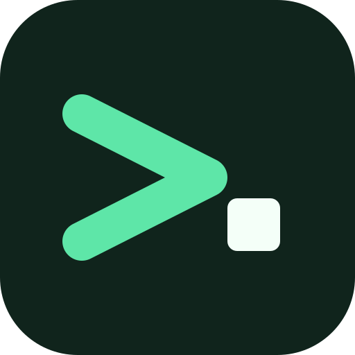
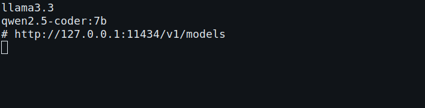
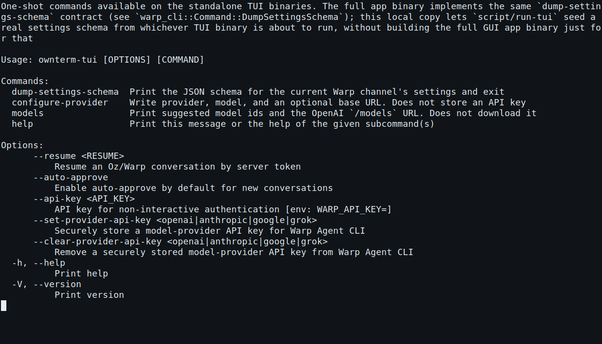

# OwnTerm

<p align="center">
  
</p>

<p align="center">
  <strong>A local terminal you can point at your own model.</strong><br>
  No Warp account, no telemetry upload, no subscription check.
</p>

<p align="center">
  <a href="https://github.com/lcajigasm/ownterm/releases/latest"></a>
  <a href="https://lcajigasm.github.io/ownterm/"></a>
  <a href="https://github.com/lcajigasm/ownterm/actions/workflows/ci.yml"></a>
  <a href="https://github.com/lcajigasm/ownterm/actions/workflows/pages.yml"></a>
  <a href="LICENSE-AGPL"></a>
  <a href="LICENSE-MIT"></a>
  <a href="https://github.com/lcajigasm/ownterm/actions/workflows/audit-services.yml"></a>
</p>

OwnTerm is a fork of the Warp terminal client. The shell, blocks, and editor stay on this machine. Agent requests go only to the OpenAI-compatible endpoint you configure: Ollama, LM Studio, vLLM, LocalAI, or a cloud API you choose. The `ownterm` binary does not sign you in, does not upload telemetry or crash reports, and does not talk to Warp's servers.

The desktop app is `ownterm`. `ownterm-tui` is the same terminal without a GPU window, for SSH. Day-to-day steps live in [docs/usage.md](docs/usage.md). The gap list is [docs/ROADMAP.md](docs/ROADMAP.md). What we took from upstream after the fork, and what we left, is [docs/upstream-review.md](docs/upstream-review.md).

## How this differs from Warp

| | OwnTerm | Warp's product client |
| :--- | :--- | :--- |
| Account | Not required. The shell starts immediately. | A Warp account is part of the product. |
| Telemetry and crash upload | Not sent. Events are not constructed on the OSS channel. | The product client reports usage and crashes. |
| Subscription and credits | Not checked. With no model, the prompt says to configure a provider. | Agent use is tied to Warp billing. |
| Model | Any OpenAI-compatible endpoint, including one on localhost. | Warp's hosted models and gateway. |
| Warp Drive, teams, billing | Hidden in OSS Settings. | Core product surfaces. |
| Updates | You install a GitHub Release, or Homebrew. The app does not download builds. | Warp's updater. |

OwnTerm is not affiliated with Warp Services, Inc. "Warp" remains their trademark. Copyright and license notices from the upstream tree stay in place.

## Screenshots

These frames are `ownterm-tui` running under Xvfb, taken by [`script/capture-ownterm.sh`](script/capture-ownterm.sh). The release workflow runs that script on a tag and on `workflow_dispatch`. They are not drawings of the window.





The macOS disk image opens the desktop app, `OwnTerm.app`, with the same terminal model.

## Install

### Homebrew

The tap [`lcajigasm/homebrew-tap`](https://github.com/lcajigasm/homebrew-tap) installs the release archives (the `.tar.gz` files, which the formula checksums). It does not use the disk image.

```bash
brew install lcajigasm/tap/ownterm
```

### macOS disk image

Download [ownterm-macos-universal.dmg](https://github.com/lcajigasm/ownterm/releases/latest/download/ownterm-macos-universal.dmg) from the latest release. Open it and move **OwnTerm.app** to Applications. The app is a universal binary (Apple Silicon and Intel) and uses the OwnTerm icon. It is not code-signed. macOS may ask you to allow it in Privacy & Security the first time.

If a release cannot combine the two Mac builds, it publishes `ownterm-macos-arm64.dmg` and `ownterm-macos-x86_64.dmg` instead. The `.tar.gz` archives stay on every release for Homebrew and for the installer script.

### Archives

| Platform | Package |
| :--- | :--- |
| macOS, both architectures | [ownterm-macos-universal.dmg](https://github.com/lcajigasm/ownterm/releases/latest/download/ownterm-macos-universal.dmg) |
| macOS Apple Silicon | [ownterm-macos-arm64.tar.gz](https://github.com/lcajigasm/ownterm/releases/latest/download/ownterm-macos-arm64.tar.gz) |
| macOS Intel | [ownterm-macos-x86_64.tar.gz](https://github.com/lcajigasm/ownterm/releases/latest/download/ownterm-macos-x86_64.tar.gz) |
| Linux x86_64 | [ownterm-linux-x86_64.tar.gz](https://github.com/lcajigasm/ownterm/releases/latest/download/ownterm-linux-x86_64.tar.gz) |
| Windows x86_64 | [ownterm-windows-x86_64.tar.gz](https://github.com/lcajigasm/ownterm/releases/latest/download/ownterm-windows-x86_64.tar.gz) |

Check `SHA256SUMS` on the release before you open an unsigned archive. From a checkout, `bash script/install-ownterm.sh` downloads the archive for this machine, checks the sum, and copies `ownterm` and `ownterm-tui` to `~/.local/bin`.

## Providers

A model id is required before an agent request. `auto` asks OwnTerm to choose. Environment variables override `~/.ownterm/provider.env`. The file may contain `provider`, `model`, `base_url`, and optionally `api_key_env`. It is rejected if it contains `api_key`, `token`, or `secret`. Put a cloud key in the environment variable named by `api_key_env` (default `OWNTERM_API_KEY`). The key is never written to the file.

```bash
ownterm-tui configure-provider --provider ollama --model llama3.3
ownterm-tui models --provider ollama
```

Or in the desktop app: Settings, Warp Agent, **Local provider**. The model list is the same one `ownterm-tui models` prints. It does not download `/models`.

| `provider` | Default base URL | Key |
| :--- | :--- | :--- |
| `ollama` | `http://127.0.0.1:11434/v1` | no |
| `lmstudio` | `http://127.0.0.1:1234/v1` | no |
| `vllm` | `http://127.0.0.1:8000/v1` | no |
| `localai` | `http://127.0.0.1:8080/v1` | no |
| `openai` | `https://api.openai.com/v1` | `OWNTERM_API_KEY` |
| `xai` | `https://api.x.ai/v1` | `OWNTERM_API_KEY` |
| `openrouter` | `https://openrouter.ai/api/v1` | `OWNTERM_API_KEY` |
| `groq` | `https://api.groq.com/openai/v1` | `OWNTERM_API_KEY` |
| `compatible` | set `base_url` | optional |

HTTP is accepted only for localhost and loopback. Other endpoints must be HTTPS.

```bash
export OWNTERM_PROVIDER=ollama
export OWNTERM_MODEL=llama3.3
ownterm
```

For a cloud provider, export `OWNTERM_API_KEY` in the environment. Do not put the key in the command line of a shared note. Workflows in `~/.ownterm/workflows` show up in command search and the `/` menu. They are files on this machine. The longer guide is [docs/usage.md](docs/usage.md).

## Auto mode

Set the model to `auto` (Settings, or `model=auto` in `provider.env`). OwnTerm classifies the prompt on this machine, then picks the cheapest catalog model that is actually available and meets that task. Warp's custom model routers are a different feature: they send a YAML map to Warp's servers. Auto does not.

Availability is local and free of paid API calls. A cloud provider counts when its key variable is set. The provider named in `provider.env` also accepts `OWNTERM_API_KEY` or the file's `api_key_env`. Other clouds use `OWNTERM_OPENAI_API_KEY`, `OWNTERM_XAI_API_KEY`, `OWNTERM_OPENROUTER_API_KEY`, or `OWNTERM_GROQ_API_KEY`. A local preset counts when its loopback port accepts a connection. The key itself is never stored.

The classifier is fixed: a one-line shell command, a short chat, an agent request (implement, refactor, numbered steps, and similar), or a long context (a long paste, a large code fence, or a diff). Agent tasks require tool calling. Long context requires a code-capable model and a larger window. Prices, context, and capabilities live in `crates/ownterm_provider/catalog.json`, dated `priced_on`. Local models cost $0. Rows marked approximate are not a vendor's current price table.

If the chosen call fails with an error, a rate limit, or a timeout before any output, Auto tries the next candidate. The transcript starts with one line naming the model and why. Settings shows the same kind of line for a short chat, plus any session pin.

A session pin overrides Auto. In Settings, the session field takes `provider/model` (`openrouter/openai/gpt-4o-mini` for the OpenRouter row). `auto` or an empty field clears it. The same pin is `ownterm-tui pin-model openai/gpt-4o-mini`, and `ownterm-tui auto --prompt "git status"` prints the ranking without calling a model.

```bash
ownterm-tui configure-provider --provider ollama --model auto
ownterm-tui auto --prompt "refactor the parser and then run the tests"
```

## Agent tools

A configured model can call five tools, and the terminal runs them on this machine. `run_shell_command` and `read_files` were already there. `grep` searches file contents, `file_glob` lists paths, and `apply_file_diffs` edits a file with search-and-replace, creates a file, or deletes one. The same confirmation path Warp uses for a diff still applies. There is no Warp-hosted code index: grep and glob do not call out.

The model sees those names on the chat request. A later turn gets the tool result back (matching lines, paths, or whether the diff applied), so it can keep going without you pasting the output.

## Shortcuts

Desktop app, from the fixed bindings in the client:

| Action | macOS | Linux and Windows |
| :--- | :--- | :--- |
| Agent input mode | ⌘I | Ctrl+I |
| Send the prompt to the local agent | ⌘Enter | Ctrl+Shift+Enter |
| Leave agent input | Esc | Esc |

`ownterm-tui` prints its own list with `?`:

| Key | Action |
| :--- | :--- |
| `?` | Shortcut list |
| `/` | Commands, including local workflows |
| `!` | Shell mode |
| Esc | Back to agent mode from the shell composer |
| ↑ | Input history |
| Ctrl+C | Interrupt the running command |

## Roadmap

[docs/ROADMAP.md](docs/ROADMAP.md) is the gap list against the upstream client. The next items there are a visual pass over blocks and themes, code signing, and downloading the live `/models` catalog from your endpoint. The icon in this repository is OwnTerm's, not Warp's.

## Contributing

See [CONTRIBUTING.md](CONTRIBUTING.md). Pictures of the app in the README, on Pages, or on a release have to be captures from `script/capture-ownterm.sh`, not mockups. Bug fixes can come as a pull request. Open it against `master`.

```bash
git clone https://github.com/lcajigasm/ownterm.git
cd ownterm
./script/run          # desktop app
./script/run-tui      # headless TUI
```

Rust 1.92 and protobuf are required. On Linux the GUI also needs the usual X11, fontconfig, and OpenGL packages listed in [AGENTS.md](AGENTS.md).

## License and credits

OwnTerm is a fork of the Warp client published by Warp Services, Inc. The terminal client in this repository is under the [GNU Affero General Public License v3.0](LICENSE-AGPL). The shared UI crates (`warpui`, `warpui_core`) stay under the [MIT license](LICENSE-MIT). Upstream copyright notices remain in the files that carry them.

OwnTerm does not claim the upstream work. Warp Services, Inc. holds the Warp trademark. This project is not sponsored by or endorsed by them.
